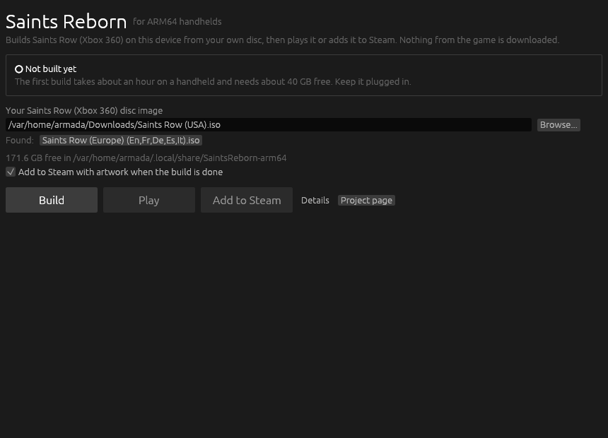
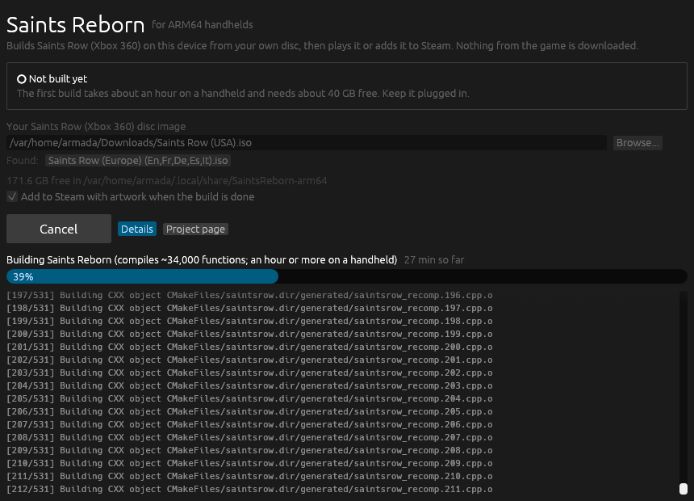

# saints-reborn-arm64

Work towards running [Saints Reborn](https://github.com/whompay/SaintsReborn)
(Saints Row for Xbox 360, recompiled with the
[ReXGlue SDK](https://github.com/rexglue/rexglue-sdk)) natively on ARM64
Linux handhelds such as the Retroid Pocket 6 with ArmadaOS, the way
[pinyon-shift-arm64](https://github.com/Ken5998/pinyon-shift-arm64) does for
Pinyon Shift.

**Status:** Saints Reborn builds for linux-arm64: the ReXGlue SDK with Saints
Reborn's patch and the Vulkan backend, and the game itself. CI checks both
natively on ARM64 and cross-compiled on x86-64. Built from a disc on the
Retroid Pocket 6, it plays at 30 fps, the game's own cap (see
[Performance](#performance)), and the build adds it to Steam with its
artwork. A [launcher](#with-the-launcher) builds and updates it from a window.
Next come the Vulkan versions of the fixes Saints Reborn made only for D3D12
([docs/FEASIBILITY.md](docs/FEASIBILITY.md)).

This repository is an overlay: patches, scripts and CI only. It never
contains the game, files extracted from your disc, or the code and binaries
generated from them, and none may be published here.

## Not in the ARM64 build

- **Online co-op and online play over Epic.** Saints Reborn ships them as a
  Windows-only online pack; this port leaves them out.
- **Zombies and the native mods** (Whompay's Trainer, the native example):
  they are Windows DLLs.
- **Code hooks in Lua mods** (`wml.hook`). They are MinHook detours, which
  only exist for x86; on ARM64 the mod log says hooks are not supported yet.
  First Person (the V key), SixtyFPS and Living Stilwater need them. Lua
  mods that read and write game memory or patch game files work.
- **World Studio**, the Windows editor.

## What is here

| Path | What it does |
| --- | --- |
| `upstream.json` | The Saints Reborn commit and the SDK commit it pins, last verified here. |
| `toolchain.json` | LLVM 20.1.8, CMake, Ninja and the ARM64 sysroot from pinyon-shift-arm64, with their checksums. |
| `cmake/toolchains/linux-arm64.cmake` | Builds for aarch64 Linux against that sysroot, natively or from x86-64. |
| `patches/sdk/` | What linux-arm64 needs on top of Saints Reborn's `patches/rexglue-sdk.patch`. |
| `patches/game/` | Saints Reborn for linux-arm64: the build, the Windows-only parts, and a guest memory safety net for AArch64. |
| `launcher/` | The launcher window (Rust, egui): runs `scripts/build.sh` from a fresh copy of this repository, then plays the game or adds it to Steam. |
| `scripts/build.sh ISO\|- [DIR]` | Everything below, from your disc to a game folder ready to play (`-` reuses the game files already extracted). |
| `scripts/fetch-toolchain.sh DEST` | Downloads and checks the toolchain. |
| `scripts/prepare.sh WORKDIR [REF]` | Checks out Saints Reborn and its SDK commit and applies all the patches; files that come out the same keep their times (`scripts/keep-times.py`), so rebuilds stay small. |
| `scripts/build-sdk.sh SDK TOOLCHAIN` | Builds and installs the SDK for linux-arm64 with Vulkan. |
| `scripts/build-game.sh SR SDK TOOLCHAIN GENERATED` | Builds the game from the recompiled code. |
| `scripts/add-to-steam.sh [DIR]` | Adds the built game to Steam with its artwork (`tools/steam_art.cpp` draws it, `scripts/add-to-steam.py` writes the entry). |
| `scripts/placeholder-codegen.py SR SDK OUT` | Stand-in recompiled code, so CI can build the game without it (the result does not run). |
| `scripts/test-safety-net.sh SR SDK TOOLCHAIN` | Checks the safety net with fake guest memory, natively or under qemu. |
| `scripts/package-launcher.sh [OUT]` | Builds the launcher and packs it for a release. |
| `.github/workflows/ci.yml` | All of it without game files, natively on an ARM64 runner in Fedora 44 (the base of ArmadaOS) and cross-compiled on x86-64; the launcher on ARM64, with its window opened on a virtual screen. |
| `.github/workflows/release.yml` | Publishes the launcher for ARM64 Linux as a release. |

## Building the game

You need your own Saints Row disc image (Xbox 360), and the handheld needs
`git`, `python3`, `curl`, `tar` and `xz`, as ArmadaOS has. The build takes
about 40 GB of space and can take an hour or more, so keep the handheld on
its charger.

### With the launcher



1. In Desktop Mode, download `SaintsReborn-Launcher-linux-arm64.tar.gz` from
   [Releases](https://github.com/Ken5998/saints-reborn-arm64/releases/latest)
   and unpack it.
2. Start `SaintsReborn/saintsreborn-launcher`. It looks for disc images in
   your home folder, Downloads, ROM folders and SD cards; **Browse...** picks
   another one.
3. Press **Build**. It fetches this repository's scripts and patches and runs
   `scripts/build.sh` (below); **Details** shows its output. When it is done,
   **Saints Reborn** is in the Steam library.



Later, **Update** gets the latest fixes and rebuilds only what they change;
the disc is not read again. **Cancel** or closing the window stops a build,
and the next one goes on from there. The launcher's log is
`~/.local/share/SaintsReborn-arm64/launcher.log`.

### From a terminal

In Desktop Mode:

```bash
git clone https://github.com/Ken5998/saints-reborn-arm64
saints-reborn-arm64/scripts/build.sh "/path/to/Saints Row.iso"
```

It downloads the toolchain, builds the SDK, extracts the game from the disc,
recompiles it and builds it; run it again to resume, finished steps are
skipped. The game ends up in
`~/.local/share/SaintsReborn-arm64/SaintsReborn/dist`, the same folder the
launcher uses, so either one can update a game the other built.

To update, pull this repository and run the same command again: only what
the new patches change is recompiled, which takes minutes rather than hours.

At the end it adds **Saints Reborn** to the Steam library as a non-Steam game
(native, no Proton) with its artwork, drawn from Saints Reborn's own logo and
icon. Steam is closed for a moment and started again, since it would
otherwise overwrite the new entry; when the entry is already there it is left
alone, launch options included. For a game built before this existed:

```bash
git -C saints-reborn-arm64 pull
saints-reborn-arm64/scripts/add-to-steam.sh
```

Start the game from Steam: on ArmadaOS the handheld's controls reach a game
only when Steam launches it. For the GPU driver, Armada Control > Compatibility > Advanced > Drivers >
Turnip **Devel** is the one that gave Pinyon Shift its best performance.

On x86-64 Linux, `build.sh` works the same with `qemu-user` installed (CMake,
Ninja and `wayland-scanner` too); copy the `dist` folder to the handheld.

## Performance

Saints Row runs at up to **30 fps**, as on the Xbox 360: the game holds
itself there. Saints Reborn's SixtyFPS mod lifts that to 60, but it needs Lua
code hooks, which this port does not have yet.

On the Retroid Pocket 6 it played at 20-30 fps at 1280 x 720. ARM64
handhelds, whose GPU is part of the SoC, now start with lighter defaults:

- **OPTIONS > DISPLAY > Resolution (restart)**: 1280 x 720, the game's own
  resolution. 2x and 3x cost far too much here (about 10 fps at 2x), and a
  change applies the next time the game starts.
- **Shadows**: Low (shadow maps only, without the stencil shadows the CPU
  builds). **Off** gives the most frame rate; it applies at once.
- The GPU work is sent once per frame, and Turnip runs without shader
  preambles (`IR3_SHADER_DEBUG=nopreamble`, as Pinyon Shift's Android build
  sets on the same GPUs). Launch options in Steam can override that, e.g.
  `IR3_SHADER_DEBUG= %command%`.
- **OPTIONS > DISPLAY > GPU Tweaks (restart)**: On by default. Three changes
  from [shiftglue-sdk](https://github.com/arcanite24/shiftglue-sdk), Pinyon
  Shift's SDK, that took GPU time off it on the same GPU (Adreno 740) with
  the same image: vertex data is read through one texel buffer instead of a
  choice among four storage buffers, vertex shaders multiply as plain IEEE
  floats, and quad lists are drawn as triangle lists. If geometry goes
  missing or flickers, turn it **Off**.
- The FPS Counter and other overlays no longer make the window redraw
  between the game's frames: each redraw ran the upscaling again on the same
  frame.

Also pick Turnip **Devel** in Armada Control (see above).

### Upscaling

The frame is drawn at the resolution above, then stretched to the screen.
**OPTIONS > DISPLAY > Upscaling (restart)** picks how:

- **Bilinear**: the original, a little soft when stretched (the default at
  1280 x 720).
- **FSR 1**: AMD FidelityFX Super Resolution 1, an edge-preserving upscale
  and sharpening. Sharper on a 1080p screen for a small GPU cost.
- **CAS**: sharpening only (Contrast Adaptive Sharpening).

**Resolution > 960 x 540 (restart)** (experimental) draws 44 % fewer pixels
than 1280 x 720 and starts with FSR 1, for when the GPU holds the frame rate.
If its menus or HUD look wrong, go back to 1280 x 720.

To measure, create an empty file named `perf_log` in the game folder
(`~/.local/share/SaintsReborn-arm64/SaintsReborn/dist`), play for a couple of
minutes and look at `saintsrow_sdk.log` there: every 2 seconds a `PERF` line
gives the frame rate and frame times, the CPU use of the busiest threads and
the GPU clock against its highest, which tells whether the CPU or the GPU
holds the frame rate. Delete `perf_log` afterwards.

## License

Apache License 2.0, like Saints Reborn. See [NOTICE](NOTICE) for the credits.
